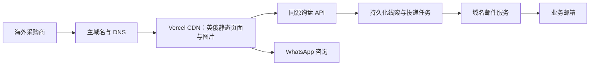

# 部署与运维方案

## 当前采用：免费个人自媒体连接站（2026-10-19）

用户明确当前仅作为个人自媒体连接站，先采用 **Netlify Free + 已有 `jiazun6888.com` + 现有 DNS**。托管月费为 0，域名年费照常续费；不购买服务器、Pro、独立 CDN、数据库或企业邮箱。保留现有页面及联系入口，不在此轮改版为链接聚合页。

此前的 Vercel Pro、线索数据库和邮件重试方案属于未来商业化选项，不再作为当前上线条件。虽然是个人持有，当前页面仍展示厂家、产品及报价入口；Vercel Hobby 明确限制为个人非商业用途，因此本方案不以 Hobby 承载当前内容。

### 免费额度与边界

- 官方定价页当前列示 Netlify Free 每月 **300 credits**，生产发布、流量、请求和计算等共享额度，不能把额度换算成固定访问人数。免费档采用硬限额，不产生超额费用；达到限额可暂停整个账号的站点，下一计费周期恢复或由用户主动选择升级。创建时再次核对控制台，旧账号可能属于不同套餐。
- 自定义域名、SSL 和 CDN 包含在免费方案中。先沿用 DNSOWL 管理解析，不必为了免费托管迁移 DNS。
- WhatsApp 和现有 `163.com` 邮箱可直接作为连接入口；EmailJS 属于独立服务，只有配置有效且免费额度够用时才有邮件表单能力。本站目前没有询盘数据库，不能声称提交必然保存或送达。
- 不启用付费附加项；关注 50%、75%、100% 用量通知。内容修改先用预览验收，再集中发布生产版本，降低构建和流量用量。

### 免费上线步骤

1. 在 Netlify 选择 Free，从 Git 导入仓库，生产分支 `master`，框架 Next.js，项目目录为仓库根目录。仓库 `netlify.toml` 已准备 Node 24、`npm run build`、`.next` 发布目录及现有安全响应头。由平台自动提供当前 Next.js 适配器，无需锁定旧插件。
2. 设置 `NEXT_PUBLIC_SITE_URL=https://jiazun6888.com`；如需邮件表单，填入实际 EmailJS 三项公开变量，不复制占位值。Netlify 不会自动读取本机环境文件，需要在控制台配置后重新部署。
3. 先用平台分配的预览地址验收英俄页面、语言跳转、404、图片优化、筛选、联系入口及响应头。官方说明支持现代 Next.js，但适配层仍需以本项目实际部署结果验收。
4. 在 Domain management 添加根域和 `www.jiazun6888.com`，将根域设为 primary。仅按该站控制台给出的记录修改现有 DNS；不要复用 Vercel 解析值，也不要删除无关邮件和所有权验证记录。
5. 等待 HTTPS 证书签发，核验 HTTP→HTTPS、www→根域，路径和查询参数保留；核验 sitemap 与 canonical 使用新域。确认后把域名放到自媒体主页。
6. 后续只需推送更新、观察额度、按期续费域名。达到真实流量或功能需求后，再讨论付费升级或静态化迁移。当前未创建 Netlify 站点、修改外部 DNS 或正式发布。

纯静态 Cloudflare Pages 也可作为后续选项，但当前 Proxy 与默认图片优化需要改造；为先免费上线，不进行这项额外迁移。

官方依据：[Netlify 定价及免费硬限额](https://www.netlify.com/pricing/)、[Netlify Next.js 支持](https://docs.netlify.com/build/frameworks/framework-setup-guides/nextjs/overview/)、[绑定已有域名](https://docs.netlify.com/manage/domains/configure-domains/bring-a-domain-to-netlify/)、[Vercel 商业用途定义](https://vercel.com/docs/limits/fair-use-guidelines)。

---

## 此前商业外贸站评估（保留作后续参考）

## 2026-10-19 10:58

### 推荐结论

对于面向中亚、中东及其他海外市场的单个 B2B 询盘站，优先采用：**企业自有国际主域 + Vercel Pro + 平台 CDN + 同源询盘接口 + 持久化线索库 + 域名邮件**。Cloudflare 可只提供 DNS，初期不叠加代理 CDN。

原始代码默认网址为 `https://solarlight.kz`，因此此前评估过 `.kz` 的本地托管条件。用户现已申请 `jiazun6888.com`，当前按下文“新域名落地清单”准备国际主域部署。若未来确需使用 `.kz`，仍应核对注册状态、适用规则及境内托管条件；若旧站已有收录和客户认知，再单独评估迁移与重定向。

本文件是部署设计，未创建云资源、购买服务、更改 DNS 或执行发布。域名所有权、真实访客地区、月流量和现有服务账户尚未确认；以下容量及总预算为起步规划，不是平台报价或性能保证。

### 项目依据

- Next.js 16.3.1 / React 19 / next-intl，英俄双语；本轮优化后 40 个内容 URL 静态预生成。
- 产品及站点资料在本地 JSON，图片在 `public`，无需为目录增加数据库或 CMS。
- 仍使用语言 Proxy 与默认 `next/image` 优化，因此静态预生成不等于可直接上传 `out` 目录。
- 当前询盘由浏览器调用 EmailJS，尚无线索数据库和投递重试闭环。
- 现有 `vercel.json` 已设置响应头，但部分 CSP 配置宽松，且未来邮件、监测等服务需重新核对放行范围。

### 三种路径比较

| 路径 | 适用条件 | 优点 | 代价与结论 |
| --- | --- | --- | --- |
| 国际主域 + Vercel Pro | 多国市场，域名可海外托管，优先减少维护 | 原生 Next.js 发布，保留静态生成、语言路由与图片优化，预览和回滚简单 | 推荐默认路径；商业站使用 Pro，关注用量与图片费用 |
| `.kz` + 哈萨克斯坦境内 Node/Docker 托管 | 必须保留 `.kz` 或以哈萨克斯坦本地业务为主 | 域名与托管要求容易保持一致，保留现有域名与搜索资产 | 推荐的 `.kz` 路径；需要维护服务、备份及监控，优先选有代运维的本地托管 |
| Cloudflare Workers | 明确偏好 Cloudflare，且能够验收当前框架适配层与目标地区访问 | 静态资产和计算可集中管理 | 本站初期不优先迁移；截至核查日，官方新项目首推 vinext，OpenNext 为另一条维护路径，不能沿用旧的部署模板假定完全兼容 |

Cloudflare Pages 的纯静态导出属于另一个改造方案：需重新处理语言重定向、图片优化和询盘接口。当前项目不应仅添加 `output: 'export'` 后直接上线。

### 推荐架构：国际主域

**发布与运行**

- 一个正式域名、一套站点、一套产品内容，英俄继续用 `/en` 与 `/ru`，无需为了语言拆成两个站。
- Vercel 绑定 Git 仓库，生产分支为当前 `master`；其他改动先生成预览，检查通过后发布。
- Node.js 固定 `24.x` LTS，使用锁文件安装；统一执行 `npm ci`、Lint、测试、生产构建。开发与 CI 也使用同一主版本。
- 内容更新通过 JSON/图片提交触发重新构建；当前规模不需要 CMS、多区域数据库或 Kubernetes。
- 静态页由平台 CDN 分发。只有询盘等动态功能需要选运行地区：以德国/中欧为候选起点，函数和数据库同区，再用目标地区实测决定；函数地区并不决定静态页只能从该地区访问。
- Cloudflare DNS 记录使用 DNS-only，不叠加代理。HTTPS、防火墙、限流由实际流量入口的平台负责；DNS-only 不提供网站流量的 Cloudflare WAF 防护。

**询盘必须可追踪**

现有 EmailJS 可用于短期过渡，正式运营建议替换为同源 `POST /api/inquiries`：

1. 校验字段长度、联系方式、来源站点和请求体大小，配置共享限流及隐藏诱捕字段。
2. 使用幂等键避免重复提交，在一个事务中保存线索与邮件投递任务。
3. 数据保存成功后才显示已接收及询盘编号；数据库失败时保留用户输入并给出重试及备用联系方式。
4. 邮件通知失败不丢失线索，定时任务重试待投递记录并对连续失败报警。不能依赖 Serverless 返回响应后继续执行的普通 Promise。
5. 区分已保存、邮件服务已接收、退信等状态，不能把接口成功当成客户或业务员已收到邮件。

国际主域路径可采用同区托管 PostgreSQL（例如 Neon）及交易邮件服务（例如 Resend）。只有业务员接收通知时需要交易邮件，客服人工收发则使用独立企业邮箱。供应商用量和可达性验收后再确定付费档位。

数据至少保存：询盘编号、时间、语言、产品、数量、目的地、联系方式、内容、落地页、营销来源、投递状态和重试次数。不在统计事件或公开日志中记录姓名、邮箱及询盘正文。

邮件由已验证的企业域名发送，配置 SPF、DKIM、DMARC；客户邮箱放在 Reply-To，不能伪装成发件人。当前 `163.com` 邮箱可保留作备用通知地址，官网正式联系地址建议使用企业域名邮箱。

WhatsApp 与站内询盘并列，不能把 WhatsApp 点击当成已获得有效询盘。验证码若采用第三方服务，应实测目标市场可用性，避免加载失败直接阻止询盘。

### 保留 `.kz` 的架构

- KazNIC 官方 FAQ 明确涉及网站等资源服务器位于哈萨克斯坦的要求，并说明 DNS 服务器位置不受同样限制；注册规则页同时列有 2026 年更新。应让注册商确认该域名当前适用条件与 CDN 使用方式。
- 在符合条件的境内服务上运行 Linux + 反向代理 + Node 24，或使用提供 Node/Docker 的境内托管平台。低流量站可从约 2 vCPU / 4 GB 内存的容量评估起步，最终按压测确定。
- 在 CI 构建不可变部署包，服务器直接启动已验证版本，减少服务器构建负担。
- 采用 Next.js `standalone` 时，额外打包 `public`、`.next/static`，并验证 `content` JSON 被文件追踪收集；在干净容器中访问所有路由，不能只检查首页。
- 把 `vercel.json` 的必要响应头转移到 Next 配置或反向代理；该文件不会自动作用于普通服务器。
- 应用仅监听内部端口，反向代理提供 HTTPS、请求体限制和限流；静态缓存尊重 Next 的缓存及 Vary 规则，不配置全站粗暴 Cache Everything。
- 线索库及邮件机制保持相同职责，部署地区按实际业务与适用要求确定。网站进程自动重启，数据库每日备份，定期演练恢复，并保留可回滚的前一版本。

### 缓存、图片与搜索

- 保留静态预生成，不对每次页面访问执行读取目录数据库等动态操作。
- `/_next/static` 的指纹资源使用框架的长期缓存；HTML、语言重定向和 RSC 响应尊重框架缓存键与响应头。询盘 POST、管理页面和含个人信息的响应不缓存。
- 初期保留本地图片与 `next/image`。按实际展示尺寸压缩，补全 `sizes`，仅首屏关键图片优先加载；不为当前 15 个产品引入额外对象存储。大视频或资料下载增长后再评估独立媒体存储。
- `NEXT_PUBLIC_SITE_URL` 必须在生产构建前设置为正式主域，切换域名后重新构建，保证 canonical、sitemap 与 JSON-LD 一致。
- 统一 HTTPS 和 www/非 www 的主版本；保留双语 hreflang，筛选页 canonical 指向产品目录。
- 预览使用访问保护并标注不收录；生产 robots 不应笼统阻止搜索引擎访问渲染必需的 JS/CSS。修改当前 `/_next/` 屏蔽规则后验证。
- 提交 Google Search Console、Bing Webmaster；目标市场依赖 Yandex 时也接入 Yandex Webmaster。站点验证与 sitemap 提交不等于收录或排名保证。

### 安全、统计与运维

- 数据库、邮件、任务认证密钥仅在服务端环境变量中，不能使用 `NEXT_PUBLIC_` 前缀。生产和预览使用分离凭据，预览不发送真实业务通知。
- 保留必要的响应头；CSP 先验证再收紧，去掉没有实际需要的 `unsafe-eval`。当前站点依赖静态生成，不盲目改用会迫使所有页面动态渲染的逐请求 nonce 方案。
- 选择一个主要访问统计工具，记录语言、产品浏览、WhatsApp 点击、询盘保存成功、邮件通知失败。尽量延迟加载非必要脚本，按访客地区处理适用的同意机制。
- 监测英俄首页、产品详情和询盘 API；测试探针不触发真实询盘通知。查看目标地区的实际成功率、页面体验和线索送达，不仅看服务器在线。
- 版本回滚使用上一部署。若有数据库变更，保持向后兼容，前端回滚不自动撤销数据库迁移。
- 提醒阈值与预算限制分开配置：高峰时直接停站可能丢单，不能未经业务判断就把费用阈值设为自动中止生产。

### 访问地区的特别取舍

俄语用户可能在哈萨克斯坦、乌兹别克斯坦等地，不能仅因有 `/ru` 就按俄罗斯境内流量设计。若俄罗斯境内是核心市场，需要使用当地多家网络进行端到端测试，覆盖页面、图片、脚本、表单及邮件；备用方案按实测选择。

Cloudflare 曾于 2025 年 6 月官方披露俄罗斯部分 ISP 对其流量限速及截断。这不是对所有俄语市场、所有平台或 2026 年实时可用性的结论，但足以说明不能未经测试就把 Cloudflare 代理 CDN 作为唯一入口。其他国际平台同样不能假定在目标地区永久可达。

### 预算

截至 2026-10-19 官方文档核查：Vercel Pro 平台费 **20 美元/月**，含一个部署席位和文档列示的用量额度，额外用量、席位、税费及付费附加项另计。Hobby 仅供个人非商业用途，不适合正式外贸站。

- 国际主域方案可先按 **约 30–60 美元/月** 做小流量起步预算，另留域名年费；该范围是规划估算，需把企业邮箱、数据库、邮件服务、监控、备份和超量费用一起核算。
- `.kz` 本地方案以合适的境内供应商报价为准，分别核算机器/托管、备份、邮件和代运维费用。不能仅比较 VPS 月费与 Vercel 平台费。
- 初期不购买额外 CDN、多个统计平台、独立 CMS 或复杂集群。预算优先用于线索留存、邮件投递和恢复能力。

### 实施顺序与验收

1. 确定正式域名、是否已有收录、重点国家和俄罗斯境内流量占比，按域名条件选择以上路径。
2. 固定 Node 24、安装及验证流程，设置生产/预览隔离，完成平台预览发布。
3. 补充同源询盘 API、持久化及重试、企业邮箱认证、必要限流和监测；修正 robots 与响应头。
4. 验证全部 40 个内容 URL、双语切换、筛选、404、图片优化、canonical、sitemap；验证重复提交和邮件失败时仍保留线索。
5. 从重点市场测试访问与实际询盘通知，经授权后切换正式 DNS。保留可回滚版本，持续观察真实访问数据。

建议验收指标：关键旅程完整成功；数据库持久化与重复请求行为正确；重点地区无持续资源加载失败；有真实数据后评估移动端第 75 百分位 LCP ≤2.5s、INP ≤200ms、CLS ≤0.1。上述性能值是目标，不是当前测得结果。

### 新域名落地清单（2026-10-19）

用户已申请 `jiazun6888.com`，本项目按国际主域方案准备，主地址采用 `https://jiazun6888.com`，英文入口 `/en`、俄文入口 `/ru`。`www.jiazun6888.com` 作为备用入口，统一永久重定向到主域并保留路径及查询参数。上文 `.kz` 为备选条件说明，不是本次主域方案的前置要求。

本地已把页面 metadata、canonical、JSON-LD、sitemap、robots、公开 AI 说明文件和环境变量示例切换为新域名；已取消 robots 对 `/_next/` 的整体屏蔽，使搜索引擎能加载页面所需资源。联系邮箱继续使用现有 `15866126888@163.com`，域名注册本身不会自动开通企业邮箱。

| 步骤 | 配置与验收 |
| --- | --- |
| 1. 托管项目 | 将仓库导入 Vercel Pro，框架选择 Next.js，根目录为本项目，生产分支 `master`，Node 24.x；用锁文件安装，验证测试、lint 和构建通过。 |
| 2. 生产变量 | 在 Production 设置 `NEXT_PUBLIC_SITE_URL=https://jiazun6888.com`；按现有表单实际配置填写 EmailJS 三项公开参数。网站地址是构建期变量，更新后必须重新部署。预览启用访问保护，不使用生产通知凭据。 |
| 3. 绑定域名 | 在项目 Settings → Domains 添加 `jiazun6888.com` 和 `www.jiazun6888.com`，把 www 设置为重定向到根域。以控制台显示的域名验证、A/CNAME/TXT 值为准，不照搬旧教程中的固定 IP。 |
| 4. DNS 变更 | 可直接在现有 DNS 服务商添加 Vercel 要求的记录，无需为了上线先迁移到 Cloudflare。核对并替换与网站绑定冲突的根域/www 记录；保留无关邮件及验证记录。若后续采用 Cloudflare，先完整迁移现有记录，网站记录初期用 DNS-only。 |
| 5. 证书与跳转 | 等待 Vercel 域名状态有效、证书签发成功；检查 HTTP→HTTPS、www→根域，确认 `/ru/products` 等路径和筛选查询参数保留，不能出现跳转循环。 |
| 6. 上线验收 | 检查全部 40 个内容 URL、404、图片、双语切换及真实询盘送达；核对 sitemap、canonical、hreflang 和 JSON-LD 使用新域名，robots 允许必需资源；从目标市场测试访问。 |
| 7. 搜索与邮箱 | 验证 Search Console/Bing/Yandex 所需所有权并提交 `https://jiazun6888.com/sitemap.xml`。企业邮箱实际开通后再设置 MX/SPF/DKIM/DMARC，并修改站内邮箱。 |

2026-10-19 只读 DNS 查询时，NS 为 `ns1/ns2/ns3.dnsowl.com`；根域与 www 均返回 `172.232.24.235`、`172.232.24.161`、`172.234.25.42`，未观察到 MX/TXT 应答。这只是当时查询结果，不能证明已绑定本站或证书正常；修改前应在当前服务商重新核对。尚未在此任务中创建 Vercel 项目、修改外部 DNS 或发布生产站点。

域名准备不代表询盘持久化方案已经实现。正式投放广告前，应完成上文的线索保存、投递失败重试与验收，避免仅依赖浏览器邮件发送。

### 官方依据

- [Vercel Pro 计划及价格](https://vercel.com/docs/plans/pro-plan)
- [Vercel Hobby 商业用途限制](https://vercel.com/docs/plans/hobby)
- [Vercel Node.js 版本](https://vercel.com/docs/functions/runtimes/node-js/node-js-versions)
- [Cloudflare 当前 Next.js 部署路径](https://developers.cloudflare.com/workers/framework-guides/web-apps/nextjs/)
- [Next.js 静态导出限制](https://nextjs.org/docs/app/guides/static-exports)
- [KazNIC 域名与服务器位置 FAQ](https://nic.kz/en/domains/faq)
- [KazNIC 当前规则及 2026 年更新](https://nic.kz/en/domains/rules)
- [Cloudflare 关于俄罗斯 ISP 限制的官方说明（2025-06-26）](https://blog.cloudflare.com/russian-internet-users-are-unable-to-access-the-open-internet/)

---
